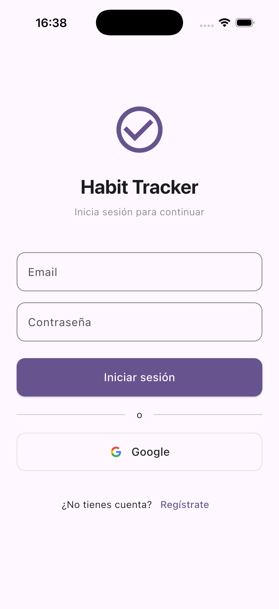
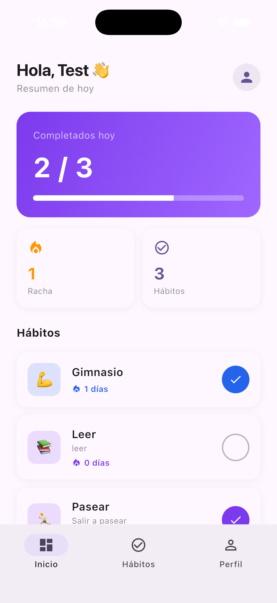
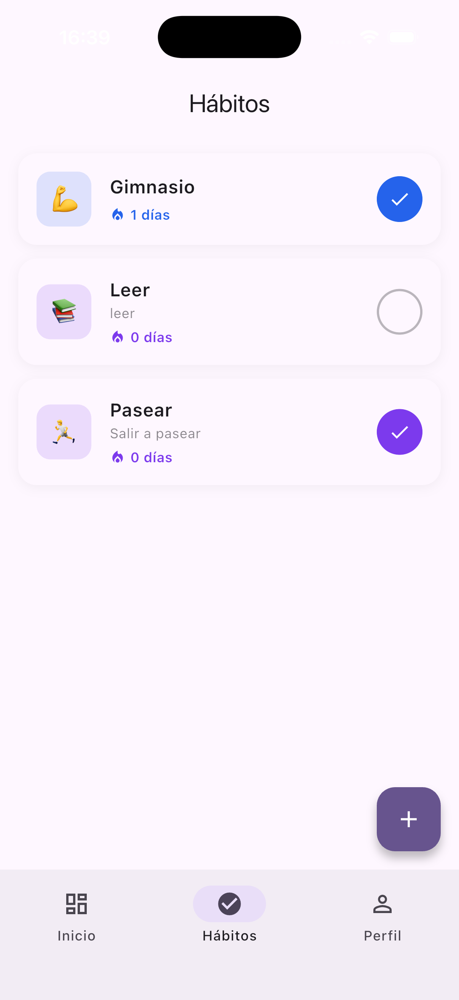
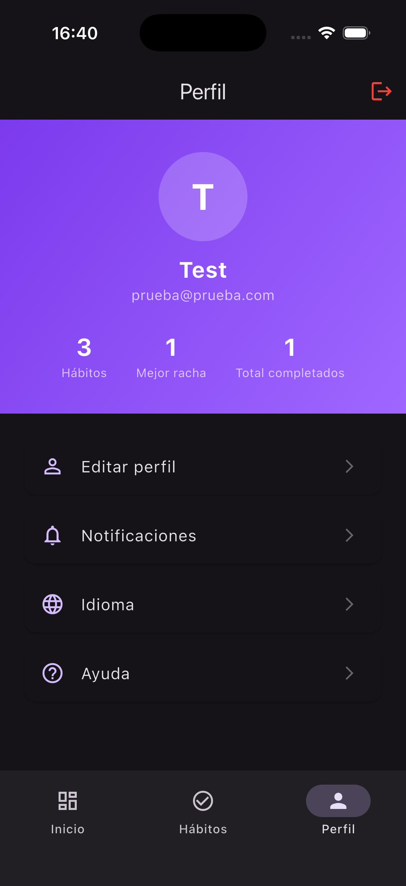
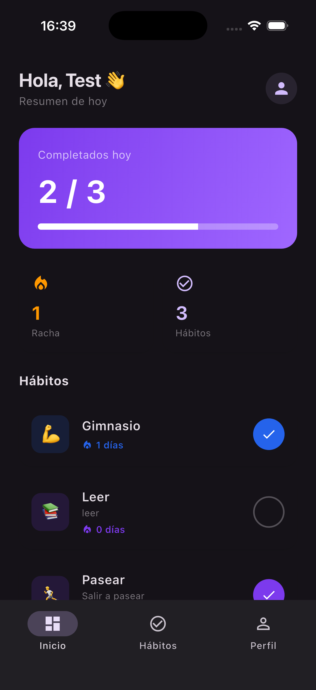
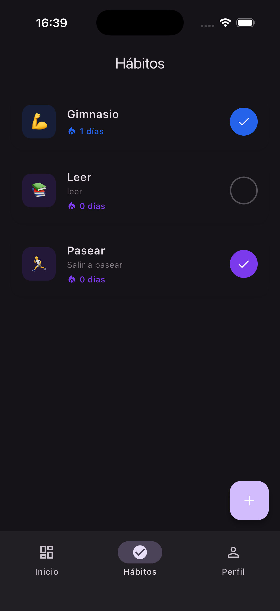

# Habit Tracker

A daily habit tracking app built as part of the [CastroDev](https://castrodev.com) portfolio. Build streaks, track your progress and stay consistent with a clean and intuitive interface — with full dark mode support.

---

## 📱 Screenshots

<p align="center">
  
  
  
  
</p>
<p align="center">
  
  
</p>

---

## ✨ Features

- ✅ **Habit tracking** — Create habits with custom icons, colors and frequency
- 🔥 **Streaks** — Track daily and best streaks automatically
- 📊 **Statistics** — View total completions and personal records
- 🌙 **Dark mode** — Automatic dark/light mode based on system settings
- 👤 **Profile** — Edit name, manage notifications and switch language
- 🌍 **Multilingual** — English and Spanish support

---

## 🛠️ Tech Stack

| Layer | Technology |
|---|---|
| Framework | Flutter |
| State Management | Riverpod |
| Error Handling | fpdart (Either) |
| Models | Freezed + json_serializable |
| Networking | Dio |
| Authentication | Firebase Auth (Email + Google) |
| Backend | .NET 10 REST API (Clean Architecture) |
| Database | Cloud Firestore |
| Infrastructure | Google Cloud Run |

---

## 🏗️ Architecture

The app follows **Clean Architecture** per feature. Presentation depends on domain abstractions only; data implementations are wired in the Riverpod providers.

```
lib/
├── core/
│   ├── config/          # API and app configuration
│   ├── errors/          # Failure types (fpdart)
│   ├── logging/         # AppLogger (dart:developer)
│   └── network/         # Dio client with Firebase auth
└── features/
    ├── auth/            # Login, register, Google Sign-In
    ├── habits/          # CRUD habits, completions, streaks
    ├── home/            # Dashboard and navigation
    └── profile/         # Settings, notifications, language
```

Each feature follows the pattern:
```
feature/
├── data/
│   ├── datasources/     # Remote API calls
│   ├── models/          # Freezed + JSON models
│   └── repositories/    # Repository implementations
├── domain/
│   ├── entities/        # Freezed domain entities
│   ├── repositories/    # Abstract repository interfaces
│   └── usecases/        # One use case per operation
└── presentation/
    ├── pages/           # Screen widgets
    ├── providers/       # Riverpod state notifiers
    └── widgets/         # Reusable UI components
```

---

## 🧭 Technical Decisions

- **Clean Architecture per feature.** Each feature has its own `data / domain / presentation`. The domain layer is plain Dart with no Flutter, Dio or Firebase imports, so business rules can be tested without a device.
- **Riverpod with `StateNotifier` and sealed states.** Each screen state (`Loading`, `Loaded`, `Error`) is an explicit type, so the UI cannot read data that is not there. The providers are the single place where concrete implementations are wired, which also makes them easy to replace in tests.
- **`Either<Failure, T>` instead of exceptions.** Repositories catch infrastructure errors, log them with `AppLogger` and return a `Failure`. The notifiers and pages only fold the result.
- **Freezed for entities and failures.** Immutable values with equality for free, and a sealed `Failure` that forces exhaustive handling.
- **One use case per operation.** Every feature (auth, habits, profile) goes through use cases, so the rule is uniform. The trade-off is some thin classes that only forward the call; it keeps the presentation layer free of repository details.
- **Profile name saved API first, Firebase second.** Editing the name touches two systems that cannot be updated atomically. The API is saved first; if the Firebase update then fails, the previous name is restored in the API, so the user never ends up with two different names.
- **Shared .NET 10 API.** Streaks and completion rules live on the server; the app sends the Firebase ID token through a Dio client. One backend serves all the apps in this portfolio.
- **Tests with hand-written fakes.** The notifiers, repository mappings and the auth/profile flows are covered with fakes of the domain interfaces, with no mocking library.

### Other projects in this portfolio

| Project | Platform | Language |
|---|---|---|
| [finance-tracker](https://github.com/gcalvarez93/finance-tracker) | Flutter (iOS + Android) | Dart |
| [habit-tracker](https://github.com/gcalvarez93/habit-tracker) | Flutter (iOS + Android) | Dart |
| [task-manager](https://github.com/gcalvarez93/task-manager) | iOS | Swift |
| [budget-scanner](https://github.com/gcalvarez93/budget-scanner) | iOS | Swift |
| [recipe-manager](https://github.com/gcalvarez93/recipe-manager) | Android | Kotlin |
| [workout-tracker](https://github.com/gcalvarez93/workout-tracker) | Android | Kotlin |
| [castrodev-api](https://github.com/gcalvarez93/castrodev-api) | Shared backend | C# (.NET 10) |

---

## 🚀 Getting Started

### Prerequisites

- Flutter SDK
- Firebase project configured
- API running at `api.castrodev.com` or locally

### Installation

```bash
# Clone the repository
git clone https://github.com/gcalvarez93/habit-tracker.git

# Install dependencies
flutter pub get

# Generate code
dart run build_runner build --delete-conflicting-outputs
flutter gen-l10n

# Run the app
flutter run --dart-define=API_URL=https://api.castrodev.com

# Run the tests
flutter test
```

---

## 🔗 Related

- [CastroDev API](https://github.com/gcalvarez93/castrodev-api) — Shared .NET 10 backend
- [castrodev.com](https://castrodev.com) — Portfolio

---

## 📄 License

MIT © [Gabriel Castro](https://castrodev.com)

---

---

# Habit Tracker

App de seguimiento de hábitos desarrollada como parte del portfolio de [CastroDev](https://castrodev.com). Crea rachas, controla tu progreso y mantén la constancia con una interfaz limpia e intuitiva — con soporte completo de modo oscuro.

---

## ✨ Funcionalidades

- ✅ **Seguimiento de hábitos** — Crea hábitos con iconos, colores y frecuencia personalizados
- 🔥 **Rachas** — Controla rachas diarias y mejores rachas automáticamente
- 📊 **Estadísticas** — Visualiza totales completados y récords personales
- 🌙 **Modo oscuro** — Modo oscuro/claro automático según el sistema
- 👤 **Perfil** — Edita tu nombre, gestiona notificaciones y cambia el idioma
- 🌍 **Multiidioma** — Soporte para español e inglés

---

## 🛠️ Stack Tecnológico

| Capa | Tecnología |
|---|---|
| Framework | Flutter |
| Estado | Riverpod |
| Manejo de errores | fpdart (Either) |
| Modelos | Freezed + json_serializable |
| Red | Dio |
| Autenticación | Firebase Auth (Email + Google) |
| Backend | API REST .NET 10 (Clean Architecture) |
| Base de datos | Cloud Firestore |
| Infraestructura | Google Cloud Run |

---

## 🧭 Decisiones Técnicas

- **Clean Architecture por feature.** Cada feature tiene su propio `data / domain / presentation`. La capa de dominio es Dart puro, sin imports de Flutter, Dio ni Firebase, así que las reglas de negocio se prueban sin dispositivo.
- **Riverpod con `StateNotifier` y estados sellados.** Cada estado de pantalla (`Loading`, `Loaded`, `Error`) es un tipo explícito, y la UI no puede leer datos que no existen. Los providers son el único sitio donde se enlazan las implementaciones concretas, lo que también facilita sustituirlas en los tests.
- **`Either<Failure, T>` en lugar de excepciones.** Los repositorios capturan los errores de infraestructura, los registran con `AppLogger` y devuelven un `Failure`. Los notifiers y las páginas solo procesan el resultado.
- **Freezed para entidades y fallos.** Valores inmutables con igualdad gratis y un `Failure` sellado que obliga a tratar todos los casos.
- **Un caso de uso por operación.** Todas las features (auth, hábitos, perfil) pasan por casos de uso, así que la regla es uniforme. El inconveniente son algunas clases finas que solo reenvían la llamada; a cambio, la capa de presentación no conoce detalles del repositorio.
- **Nombre de perfil: primero API, después Firebase.** Editar el nombre toca dos sistemas que no se pueden actualizar de forma atómica. Se guarda primero en la API; si después falla Firebase, se restaura el nombre anterior en la API, de modo que el usuario nunca acaba con dos nombres distintos.
- **API compartida en .NET 10.** Las rachas y las reglas de completado viven en el servidor; la app envía el token de Firebase mediante un cliente Dio. Un solo backend sirve a todas las apps de este portfolio.
- **Tests con fakes escritos a mano.** Los notifiers, los mapeos de repositorios y los flujos de auth y perfil están cubiertos con fakes de las interfaces del dominio, sin librería de mocks.

### Otros proyectos del portfolio

| Proyecto | Plataforma | Lenguaje |
|---|---|---|
| [finance-tracker](https://github.com/gcalvarez93/finance-tracker) | Flutter (iOS + Android) | Dart |
| [habit-tracker](https://github.com/gcalvarez93/habit-tracker) | Flutter (iOS + Android) | Dart |
| [task-manager](https://github.com/gcalvarez93/task-manager) | iOS | Swift |
| [budget-scanner](https://github.com/gcalvarez93/budget-scanner) | iOS | Swift |
| [recipe-manager](https://github.com/gcalvarez93/recipe-manager) | Android | Kotlin |
| [workout-tracker](https://github.com/gcalvarez93/workout-tracker) | Android | Kotlin |
| [castrodev-api](https://github.com/gcalvarez93/castrodev-api) | Backend compartido | C# (.NET 10) |

---

## 🚀 Instalación

```bash
# Clonar el repositorio
git clone https://github.com/gcalvarez93/habit-tracker.git

# Instalar dependencias
flutter pub get

# Generar código
dart run build_runner build --delete-conflicting-outputs
flutter gen-l10n

# Ejecutar
flutter run --dart-define=API_URL=https://api.castrodev.com

# Ejecutar los tests
flutter test
```

---

## 📄 Licencia

MIT © [Gabriel Castro](https://castrodev.com)