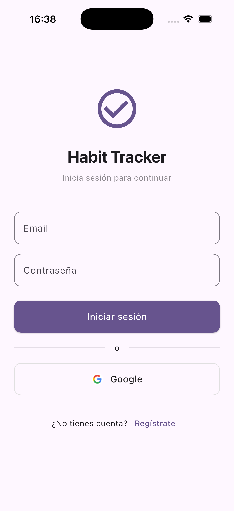
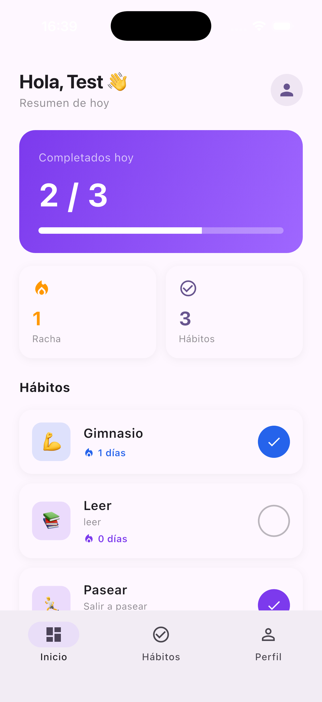
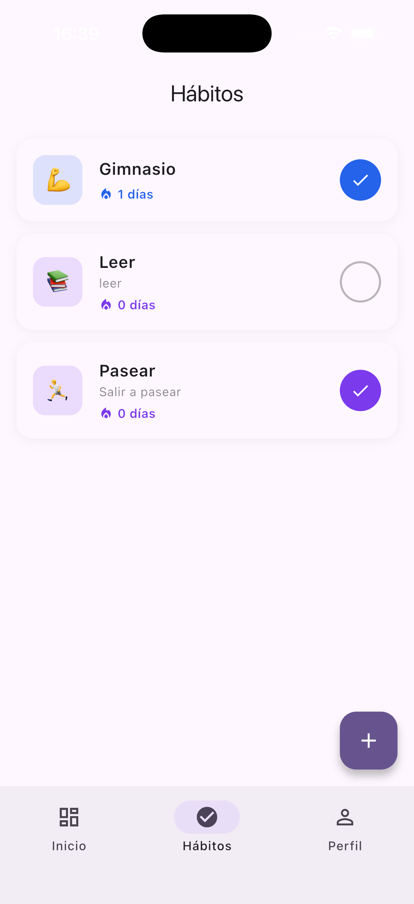
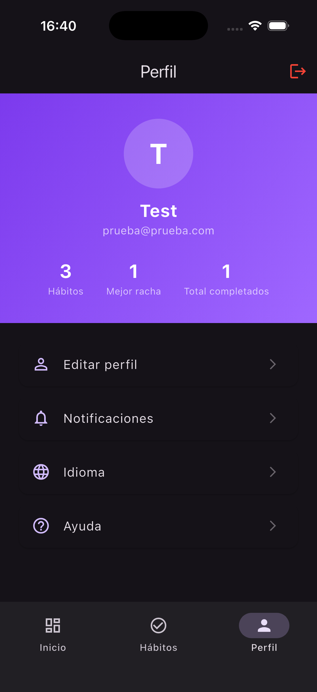
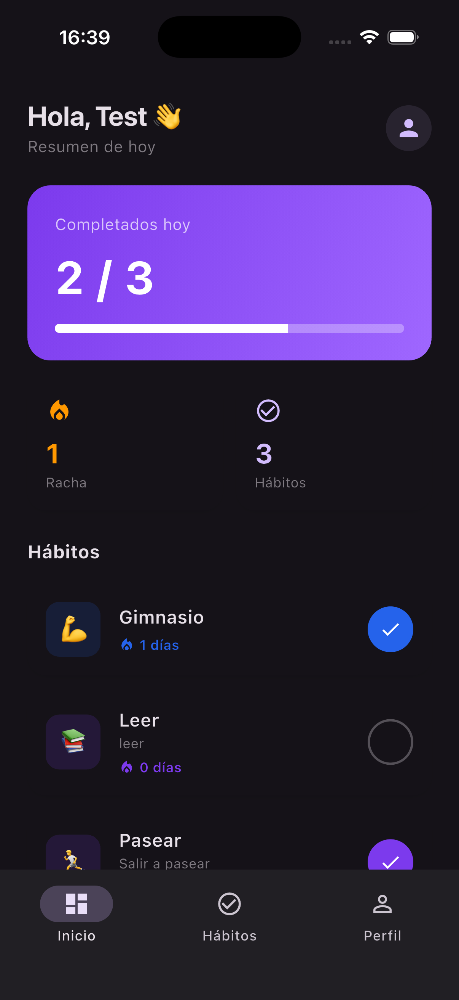
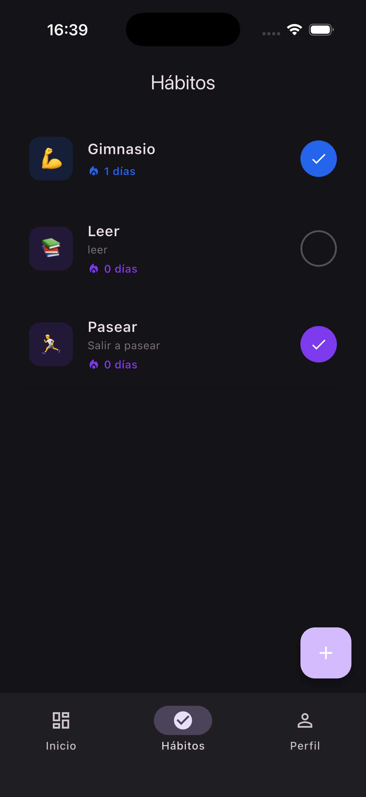

# Habit Tracker

A daily habit tracking app built as part of the CastroDev portfolio. Build streaks, track your progress and stay consistent with a clean and intuitive interface — with full dark mode support.

---

## 📱 Screenshots

<p align="center">
  
  
  
  
</p>
<p align="center">
  
  
</p>

---

## ✨ Features

- ✅ **Habit tracking** — Create habits with custom icons, colors and frequency
- 🔥 **Streaks** — Track daily and best streaks automatically
- 📊 **Statistics** — View total completions and personal records
- 🌙 **Dark mode** — Automatic dark/light mode based on system settings
- 👤 **Profile** — Edit name, manage notifications and switch language
- 🌍 **Multilingual** — English and Spanish support

---

## 🛠️ Tech Stack

| Layer | Technology |
|---|---|
| Framework | Flutter |
| State Management | Riverpod |
| Error Handling | fpdart (Either) |
| Models | Freezed + json_serializable |
| Networking | Dio |
| Authentication | Firebase Auth (Email + Google) |
| Backend | .NET 10 REST API (Clean Architecture) |
| Database | Cloud Firestore |
| Infrastructure | Google Cloud Run |

---

## 🏗️ Architecture

The app follows **Clean Architecture** per feature. Presentation depends on domain abstractions only; data implementations are wired in the Riverpod providers.

```
lib/
├── core/
│   ├── config/          # API and app configuration
│   ├── errors/          # Failure types + user-facing messages
│   ├── logging/         # AppLogger (dart:developer)
│   ├── network/         # Dio client with Firebase auth + failure mapper
│   └── widgets/         # ErrorRetryView
└── features/
    ├── auth/            # Login, register, Google Sign-In
    ├── habits/          # CRUD habits, completions, streaks
    ├── home/            # Dashboard and navigation
    └── profile/         # Settings, notifications, language
```

Each feature follows the pattern:
```
feature/
├── data/
│   ├── datasources/     # Remote API calls
│   ├── models/          # Freezed + JSON models
│   └── repositories/    # Repository implementations
├── domain/
│   ├── entities/        # Freezed domain entities
│   ├── repositories/    # Abstract repository interfaces
│   └── usecases/        # One use case per operation
└── presentation/
    ├── pages/           # Screen widgets
    ├── providers/       # Riverpod state notifiers
    └── widgets/         # Reusable UI components
```

---

## 🧭 Technical Decisions

- **Clean Architecture per feature.** Each feature has its own `data / domain / presentation`. The domain layer is plain Dart with no Flutter, Dio or Firebase imports, so business rules can be tested without a device.
- **Riverpod with `StateNotifier` and sealed states.** Each screen state (`Loading`, `Loaded`, `Error`) is an explicit type, so the UI cannot read data that is not there. The providers are the single place where concrete implementations are wired, which also makes them easy to replace in tests.
- **`Either<Failure, T>` instead of exceptions.** Repositories catch infrastructure errors, log them with `AppLogger` and return a `Failure`. The notifiers and pages only fold the result.
- **Typed failures, one mapper.** `mapToFailure` is the single place that turns a `DioException` into a `Failure` (`network`, `timeout`, `server`, `auth`, `notFound`, `rejected`, `unknown`). It compares exception types instead of using an exhaustive `switch`, so it does not break when a Dio version adds a new type. The failure `message` is for logs only and never includes the response body.
- **Localized, human error messages.** The UI never shows raw exception text (authentication shows Firebase's own message, see Known limitations): `failure.userMessage(l10n)` picks a translated message (English and Spanish) per failure type.
- **A failed reload does not wipe the screen.** If habits are already on screen and a refresh fails, the list stays and the error shows as a SnackBar (`actionFailure`). The full-screen error with a retry button appears only when there is nothing to show. Every habits screen also supports pull-to-refresh.
- **Actions report their own result.** Creating a habit returns the `Failure` to the form, which stays open with the input kept and an inline error. Deleting is optimistic and rolls back with a message if the API fails.
- **Freezed for entities and failures.** Immutable values with equality for free, and a sealed `Failure` that forces exhaustive handling.
- **One use case per operation.** Every feature (auth, habits, profile) goes through use cases, so the rule is uniform. The trade-off is some thin classes that only forward the call; it keeps the presentation layer free of repository details.
- **Profile name saved API first, Firebase second.** Editing the name touches two systems that cannot be updated atomically. The API is saved first; if the Firebase update then fails, the previous name is restored in the API, so the user never ends up with two different names.
- **Shared .NET 10 API.** Streaks and completion rules live on the server; the app sends the Firebase ID token through a Dio client. One backend serves all the apps in this portfolio.
- **Tests with hand-written fakes.** The notifiers, repository mappings and the auth/profile flows are covered with fakes of the domain interfaces, with no mocking library.

### Other projects in this portfolio

| Project | Platform | Language |
|---|---|---|
| [finance-tracker](https://github.com/gcalvarez93/finance-tracker) | Flutter (iOS + Android) | Dart |
| [habit-tracker](https://github.com/gcalvarez93/habit-tracker) | Flutter (iOS + Android) | Dart |
| [task-manager](https://github.com/gcalvarez93/task-manager) | iOS | Swift |
| [task-manager-kmp](https://github.com/gcalvarez93/task-manager-kmp) | Android + iOS | Kotlin Multiplatform + Swift |
| [budget-scanner](https://github.com/gcalvarez93/budget-scanner) | iOS | Swift |
| [recipe-manager](https://github.com/gcalvarez93/recipe-manager) | Android | Kotlin |
| [workout-tracker](https://github.com/gcalvarez93/workout-tracker) | Android | Kotlin |
| [castrodev-api](https://github.com/gcalvarez93/castrodev-api) | Shared backend | C# (.NET 10) |

---

## ⚠️ Known limitations

Deliberate trade-offs of a portfolio project, listed so they are not a surprise:

- **No session renewal on 401/403.** These are mapped to a "session" message, but the app does not refresh the token or sign the user out automatically.
- **No `sendTimeout`.** Only connection and receive timeouts are configured on the Dio client.
- **Completing a habit is not optimistic.** It waits for the API and then reloads, so on a slow network the check takes a moment to show. If it fails, the list is kept and a message is shown.
- **Test coverage is focused.** Notifiers, repositories, the failure mapper and the profile flow are covered; there are no widget or integration tests, so the visual side of the error states was checked by hand.
- **Authentication errors are not localized.** Login and registration show the message Firebase returns (in English, never the error code). Any other failure falls back to a fixed Spanish text ("Error desconocido"), hardcoded rather than taken from the ARB files, because the auth state stores a `String` instead of the `Failure`.
- **Cancelling Google sign-in shows an error.** If the user closes the Google window, the datasource throws a generic exception that ends up as the fixed "Error desconocido" message, instead of silently returning to the login screen.
- **Some text is still hardcoded.** For example the default display name "Usuario" is not localized.
- **The error core is copied, not shared.** `mapToFailure`, `Failure`, the user messages and `ErrorRetryView` also exist in finance-tracker; there is no shared package, so a change has to be applied in both.
- **Pinned code-generation tooling.** `build_runner`, `freezed` and `json_serializable` are pinned to exact versions in `pubspec.yaml` because newer analyzer versions failed to run with the current Dart SDK. Update them together.

---

## 🚀 Getting Started

### Prerequisites

- Flutter SDK
- Firebase project configured
- API running at `api.castrodev.com` or locally

### Installation

```bash
# Clone the repository
git clone https://github.com/gcalvarez93/habit-tracker.git

# Install dependencies
flutter pub get

# Generate code
dart run build_runner build --delete-conflicting-outputs
flutter gen-l10n

# Run the app
flutter run --dart-define=API_URL=https://api.castrodev.com

# Run the tests
flutter test
```

---

## 🔗 Related

- [CastroDev API](https://github.com/gcalvarez93/castrodev-api) — Shared .NET 10 backend

---

## 📄 License

MIT © Gabriel Castro

---

---

# Habit Tracker

App de seguimiento de hábitos desarrollada como parte del portfolio de CastroDev. Crea rachas, controla tu progreso y mantén la constancia con una interfaz limpia e intuitiva — con soporte completo de modo oscuro.

---

## ✨ Funcionalidades

- ✅ **Seguimiento de hábitos** — Crea hábitos con iconos, colores y frecuencia personalizados
- 🔥 **Rachas** — Controla rachas diarias y mejores rachas automáticamente
- 📊 **Estadísticas** — Visualiza totales completados y récords personales
- 🌙 **Modo oscuro** — Modo oscuro/claro automático según el sistema
- 👤 **Perfil** — Edita tu nombre, gestiona notificaciones y cambia el idioma
- 🌍 **Multiidioma** — Soporte para español e inglés

---

## 🛠️ Stack Tecnológico

| Capa | Tecnología |
|---|---|
| Framework | Flutter |
| Estado | Riverpod |
| Manejo de errores | fpdart (Either) |
| Modelos | Freezed + json_serializable |
| Red | Dio |
| Autenticación | Firebase Auth (Email + Google) |
| Backend | API REST .NET 10 (Clean Architecture) |
| Base de datos | Cloud Firestore |
| Infraestructura | Google Cloud Run |

---

## 🧭 Decisiones Técnicas

- **Clean Architecture por feature.** Cada feature tiene su propio `data / domain / presentation`. La capa de dominio es Dart puro, sin imports de Flutter, Dio ni Firebase, así que las reglas de negocio se prueban sin dispositivo.
- **Riverpod con `StateNotifier` y estados sellados.** Cada estado de pantalla (`Loading`, `Loaded`, `Error`) es un tipo explícito, y la UI no puede leer datos que no existen. Los providers son el único sitio donde se enlazan las implementaciones concretas, lo que también facilita sustituirlas en los tests.
- **`Either<Failure, T>` en lugar de excepciones.** Los repositorios capturan los errores de infraestructura, los registran con `AppLogger` y devuelven un `Failure`. Los notifiers y las páginas solo procesan el resultado.
- **Fallos tipados, un solo mapper.** `mapToFailure` es el único sitio que convierte una `DioException` en un `Failure` (`network`, `timeout`, `server`, `auth`, `notFound`, `rejected`, `unknown`). Compara tipos de excepción en lugar de usar un `switch` exhaustivo, así que no se rompe cuando una versión de Dio añade un tipo nuevo. El `message` del fallo es solo para logs y nunca incluye el cuerpo de la respuesta.
- **Mensajes de error localizados y comprensibles.** La UI nunca muestra el texto crudo de una excepción (la autenticación muestra el mensaje propio de Firebase, ver Limitaciones conocidas): `failure.userMessage(l10n)` elige un mensaje traducido (español e inglés) según el tipo de fallo.
- **Una recarga fallida no vacía la pantalla.** Si ya hay hábitos en pantalla y falla una recarga, la lista se mantiene y el error aparece como SnackBar (`actionFailure`). El error a pantalla completa con botón de reintento solo aparece cuando no hay nada que mostrar. Todas las pantallas de hábitos admiten también arrastrar para recargar.
- **Cada acción informa de su resultado.** Crear un hábito devuelve el `Failure` al formulario, que sigue abierto con lo escrito y un error en línea. Borrar es optimista y se revierte con un mensaje si la API falla.
- **Freezed para entidades y fallos.** Valores inmutables con igualdad gratis y un `Failure` sellado que obliga a tratar todos los casos.
- **Un caso de uso por operación.** Todas las features (auth, hábitos, perfil) pasan por casos de uso, así que la regla es uniforme. El inconveniente son algunas clases finas que solo reenvían la llamada; a cambio, la capa de presentación no conoce detalles del repositorio.
- **Nombre de perfil: primero API, después Firebase.** Editar el nombre toca dos sistemas que no se pueden actualizar de forma atómica. Se guarda primero en la API; si después falla Firebase, se restaura el nombre anterior en la API, de modo que el usuario nunca acaba con dos nombres distintos.
- **API compartida en .NET 10.** Las rachas y las reglas de completado viven en el servidor; la app envía el token de Firebase mediante un cliente Dio. Un solo backend sirve a todas las apps de este portfolio.
- **Tests con fakes escritos a mano.** Los notifiers, los mapeos de repositorios y los flujos de auth y perfil están cubiertos con fakes de las interfaces del dominio, sin librería de mocks.

### Otros proyectos del portfolio

| Proyecto | Plataforma | Lenguaje |
|---|---|---|
| [finance-tracker](https://github.com/gcalvarez93/finance-tracker) | Flutter (iOS + Android) | Dart |
| [habit-tracker](https://github.com/gcalvarez93/habit-tracker) | Flutter (iOS + Android) | Dart |
| [task-manager](https://github.com/gcalvarez93/task-manager) | iOS | Swift |
| [task-manager-kmp](https://github.com/gcalvarez93/task-manager-kmp) | Android + iOS | Kotlin Multiplatform + Swift |
| [budget-scanner](https://github.com/gcalvarez93/budget-scanner) | iOS | Swift |
| [recipe-manager](https://github.com/gcalvarez93/recipe-manager) | Android | Kotlin |
| [workout-tracker](https://github.com/gcalvarez93/workout-tracker) | Android | Kotlin |
| [castrodev-api](https://github.com/gcalvarez93/castrodev-api) | Backend compartido | C# (.NET 10) |

---

## ⚠️ Limitaciones conocidas

Decisiones asumidas en un proyecto de portfolio, indicadas para que no sorprendan:

- **Sin renovación de sesión en 401/403.** Se traducen a un mensaje de "sesión", pero la app no renueva el token ni cierra la sesión automáticamente.
- **Sin `sendTimeout`.** Solo hay timeouts de conexión y de recepción en el cliente Dio.
- **Completar un hábito no es optimista.** Espera a la API y recarga, así que con red lenta el check tarda un momento en verse. Si falla, se mantiene la lista y se muestra un mensaje.
- **Cobertura de tests acotada.** Están cubiertos los notifiers, los repositorios, el mapper de fallos y el flujo de perfil; no hay tests de widgets ni de integración, así que la parte visual de los estados de error se comprobó a mano.
- **Los errores de autenticación no están localizados.** Login y registro muestran el mensaje que devuelve Firebase (en inglés, nunca el código de error). Cualquier otro fallo cae en un texto fijo en español ("Error desconocido"), escrito en el código y no en los ARB, porque el estado de auth guarda un `String` en lugar del `Failure`.
- **Cancelar el inicio de sesión con Google muestra un error.** Si el usuario cierra la ventana de Google, el datasource lanza una excepción genérica que acaba en el mensaje fijo «Error desconocido», en lugar de volver al login sin avisar.
- **Queda algo de texto fijo.** Por ejemplo, el nombre por defecto "Usuario" no está localizado.
- **El núcleo de errores está copiado, no compartido.** `mapToFailure`, `Failure`, los mensajes de usuario y `ErrorRetryView` existen también en finance-tracker; no hay un paquete común, así que un cambio hay que aplicarlo en los dos.
- **Herramientas de generación de código fijadas.** `build_runner`, `freezed` y `json_serializable` están fijados a versiones exactas en `pubspec.yaml` porque las versiones nuevas del analyzer no funcionaban con el SDK de Dart actual. Actualízalas juntas.

---

## 🚀 Instalación

```bash
# Clonar el repositorio
git clone https://github.com/gcalvarez93/habit-tracker.git

# Instalar dependencias
flutter pub get

# Generar código
dart run build_runner build --delete-conflicting-outputs
flutter gen-l10n

# Ejecutar
flutter run --dart-define=API_URL=https://api.castrodev.com

# Ejecutar los tests
flutter test
```

---

## 🔗 Relacionado

- [CastroDev API](https://github.com/gcalvarez93/castrodev-api) — Backend compartido en .NET 10

---

## 📄 Licencia

MIT © Gabriel Castro